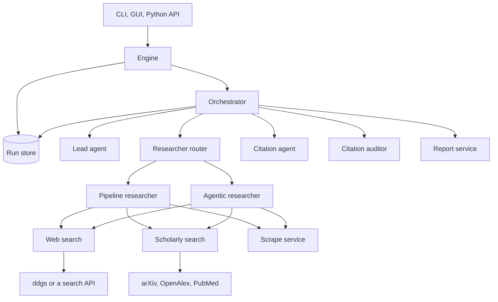
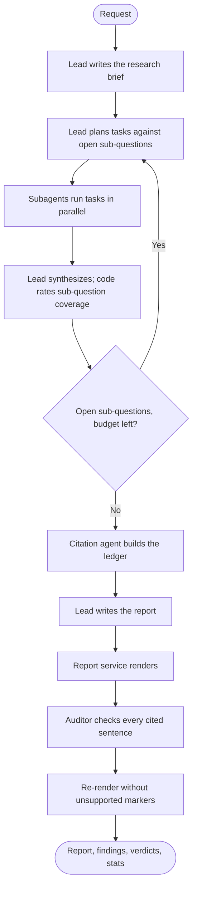
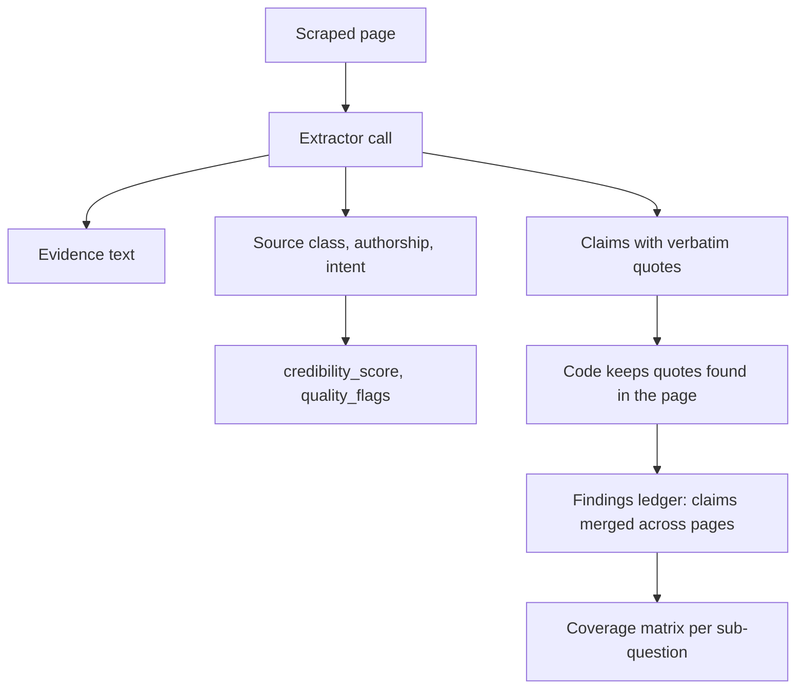

# Shandu 4.0 Architecture

This document describes how Shandu 4.0 executes a research run end to end.

## 1) System Topology

## 2) Run Lifecycle

Every step writes to the run store, so a run can be resumed after its last
completed iteration, or re-reported from stored evidence with no new searches.

## 3) Research Brief

Before planning, the lead turns the query (plus any `--clarify` answers and the
domain and date filters) into a brief: scope, 3-8 concrete sub-questions, time
window, region, source types, and the deliverable shape. The sub-questions are
the run's checklist:

- The planner tags each task with the sub-questions it serves.
- The extractor tags each claim with the sub-question it answers.
- The coverage matrix rates each sub-question after every iteration.
- The writer answers each sub-question in the deliverable's shape.

## 4) Researchers

Each task runs through one of two researchers, chosen per run with
`--researcher`:

- **Pipeline** (default): search every planned query, rank the hits with a model
  call, scrape the top pages, extract each one. A page that is blocked, empty,
  or older than `--since` is replaced by the next-ranked candidate, for up to
  two extra rounds.
- **Agentic**: a tool loop with `web_search`, `search_papers`, and `read_page`.
  The model writes sharper queries from what it reads, follows a page's outbound
  links to the primary source it cites, and stops when the task is covered.
  Tools enforce separate search and read budgets and say what is left when one
  runs out, so the loop ends with a memo, which reaches the synthesizer next to
  the evidence. A loop that stops without a memo keeps its evidence and is
  recorded as an error event.

Tasks the planner marks `scholarly` also search arXiv, OpenAlex, and PubMed.
Under `--include-domain`, a paper query carries the sites as `site:` operators
and goes only to the indexes whose result hosts sit under one of them. arXiv
runs for arxiv.org. PubMed runs for nih.gov, nlm.nih.gov, ncbi.nlm.nih.gov,
pubmed.ncbi.nlm.nih.gov, or pmc.ncbi.nlm.nih.gov, so a site such as
cancer.nih.gov does not select it. OpenAlex always runs, because its links
include publisher pages.
An index whose rate limit is spent sits out the wait it names, and the others
continue; keyless OpenAlex allows about 100 searches a day.
Pages an iteration's tasks start reading go into a shared set, so parallel tasks
do not extract the same page twice.

## 5) Evidence Model

- **Credibility** comes from a pure scoring function over the extractor's source
  classification: a per-class tier, minus penalties for undated, anonymous,
  promotional, and secondhand pages. A page whose publisher writes about itself
  is classed by what it contains and flagged rather than scored down, so the
  writer cites it for its own facts and attributes its measurements to it.
- **Claims** keep only quotes that appear verbatim (ignoring whitespace and case)
  in the text the extractor read.
- **Findings** merge claims whose word sets overlap by 80% or more, carrying every
  supporting evidence id, quote, and site.
- **Coverage** rates each sub-question: none, weak (no credible page), moderate
  (credible pages from one site), or strong (credible pages from two or more
  independent sites).

## 6) Stopping Rules

- The adaptive loop continues while any sub-question is short of strong or
  sources conflict, until `max_iterations`. It also stops when an iteration
  adds no finding or credible source to any sub-question. When the brief call
  fails, the query itself becomes the one sub-question.
- `--max-cost` stops research before the next iteration once metered spend
  reaches the budget; the report is still written. A model that reports no
  price cannot be budgeted, and the run emits an event saying so.
- `--effort low|medium|high|max` sets iterations, parallel subagents, pages and
  searches per task, and results per query together.
- A model call the provider refuses in a way no retry fixes (a rejected API
  key, an unknown model, an account out of credit) stops the run, which is
  marked failed with the provider's message. Any other failed call falls back
  and the run goes on.

## 7) Writer

One call writes the report from compacted evidence: cited records first, then
the rest by credibility, inside a fixed character budget. The outline follows
the question: the brief's deliverable sets the starting shape, a structure the
query asks for overrides it, and headings name what each section establishes.
Length follows the evidence too: the writer stays under 300 words per cited
source it receives, never less than 400, and a detail level other than `auto`
lowers that ceiling.
A reply that is empty or carries no heading (a provider refusal in place of
the report) is retried, and after three attempts a deterministic report is
built from the syntheses.

## 8) Citation Guarantees

- Final reports use numeric markers only (`[1]`, `[2]`, ...); internal evidence
  ids never reach the rendered markdown.
- References are rebuilt from the citation ledger; unused entries drop out and
  the rest renumber.
- Evidence below the credibility bar stays out of the ledger unless nothing
  stronger exists. Copies of one work merge into one entry: an article's HTML
  and PDF, a DOI page and its publisher page, an arXiv abstract and full text,
  and the same long title on two sites. Two DOIs, or two arXiv ids, that differ
  keep works apart whatever their titles.
- Markers for citations the ledger does not hold, and placeholders a writer
  prints in place of a citation, are removed with the space before them.
- Tables with a dedicated provenance column are rewritten at render time.
- The auditor checks every cited sentence, bullet, and table row against the
  evidence text and verified quotes behind each marker, and removes unsupported
  markers. Verdicts are recorded on the result and counted in the run stats.

## 9) Run Store

Each run lives in `<storage_dir>/runs/<run_id>/`:

| File | Contents |
|---|---|
| `request.json`, `settings.json` | The request and the runtime settings it ran under |
| `status.json` | Status, timestamps, error, whether research finished |
| `brief.json` | The research brief |
| `events.jsonl` | Every run event, appended live |
| `evidence.jsonl` | Evidence records with their iteration, after every task |
| `iterations.json` | Each completed iteration's plan, synthesis, and counters |
| `citations.json`, `report.md`, `result.json` | The rendered report, its ledger, run stats |

## 10) Module Boundaries

- Engine: public entry point (`run`, `resume`, `rewrite_report`, `stream`,
  `inspect_run`, `list_runs`, `ai_search`).
- Orchestrator: brief, loop control, task fan-out, coverage, stopping, report
  assembly, audit, persistence.
- Lead agent: brief, clarifying questions, planning, synthesis, the report.
- Researchers: evidence gathering per task; extraction and source scoring.
- Citation agent: deterministic ledger.
- Citation auditor: per-marker support verdicts.
- Findings service: claim verification, findings ledger, coverage matrix.
- Search services: ddgs or a search API for the web; arXiv, OpenAlex, and PubMed
  for papers.
- Scrape service: layered HTML extraction, document parsers, outbound links,
  publication dates, SSRF-safe fetching with per-domain backoff.
- Report service: marker normalization and rendering.
- Run store: one directory per run.
- Runtime: model wiring, per-role models, async bridge, and deadlines on
  structured calls (420 s), each writing attempt (900 s), and each agentic task
  (1200 s), so a stalled provider falls back instead of holding the run.
