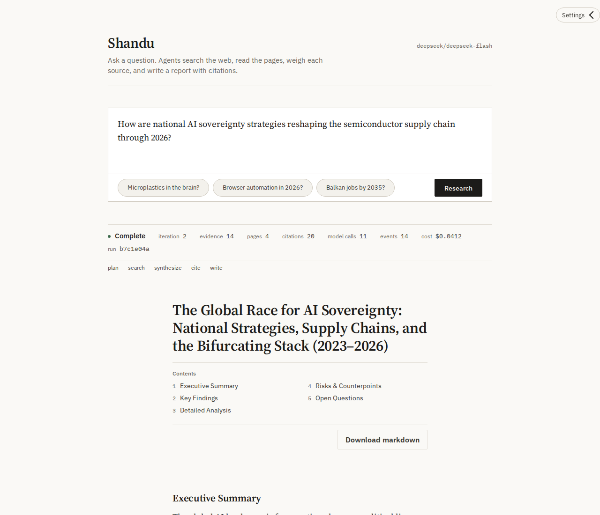
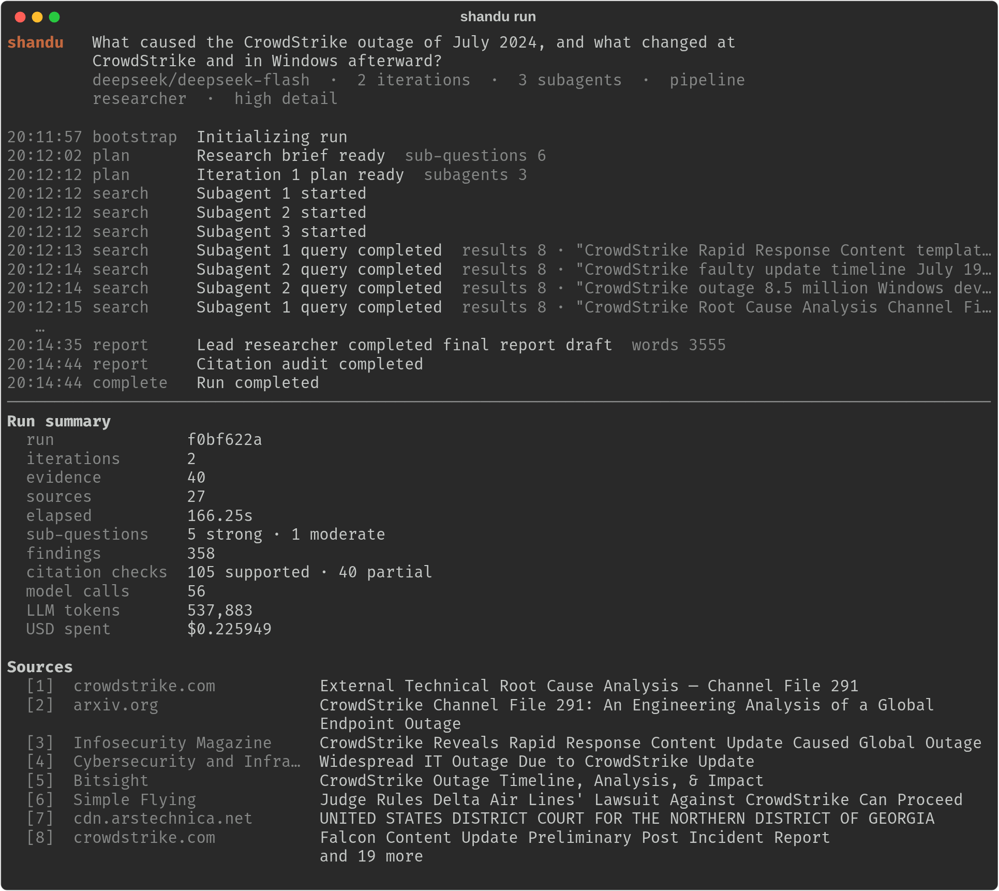
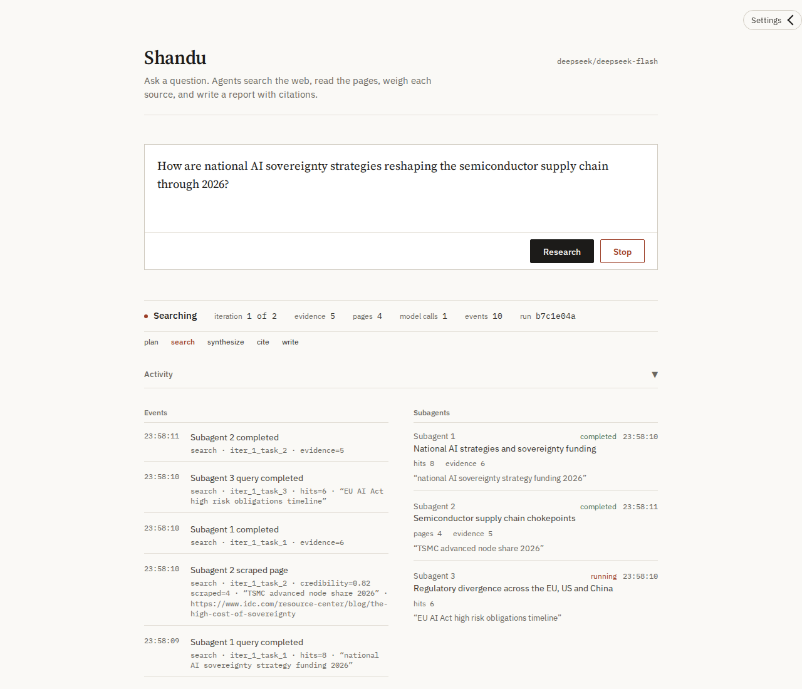
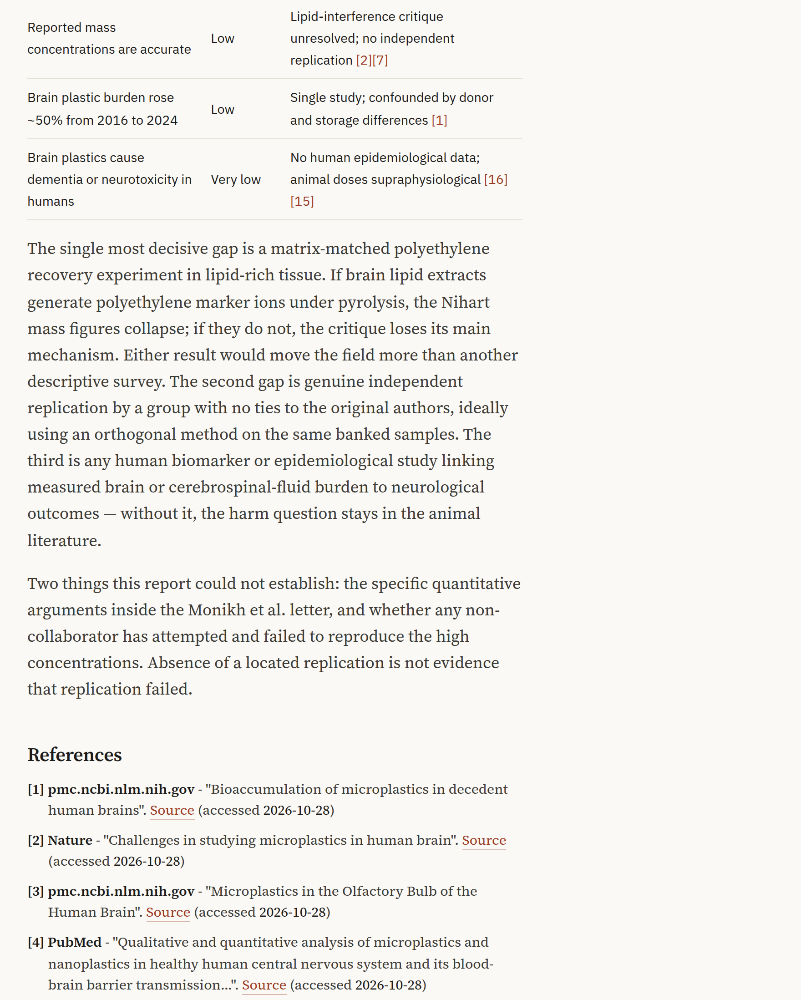

# Shandu

Shandu is an open-source deep research agent. Ask a question, and LLM agents
plan the research, search the web and scholarly indexes, read pages and PDFs,
weigh each source, and write a markdown report with numbered citations that are
checked against the sources. It runs on your machine, from a terminal or a web
GUI, with any model [LiteLLM](https://docs.litellm.ai/) supports.



Example reports, each written by `deepseek/deepseek-flash` with its thinking
turned off:

- [The CrowdStrike outage of July 2024](examples/crowdstrike-outage.md): default
  effort, 27 sources, 3 minutes.
- [Microplastics in human brain tissue](examples/microplastics-in-the-brain.md):
  default effort, 15 sources, 3 minutes.
- [KV-cache compression for long-context inference](examples/kv-cache-compression.md):
  high effort, 22 sources, 5 minutes.

The architecture is described in [`ARCH.md`](ARCH.md).

## How a run works

1. The lead agent turns the question into a brief: scope, sub-questions, time
   window, and the kind of answer wanted.
2. Each iteration plans tasks for the sub-questions that are still open.
   Subagents run the tasks in parallel. They search the web and, when papers
   can answer a task, arXiv, OpenAlex, and PubMed, then read the best pages
   whole.
3. Every page is classified (peer-reviewed, official, journalism, vendor, blog,
   and so on) and scored for credibility. Claims are extracted with verbatim
   quotes, and a claim whose quote is not on the page is dropped.
4. Code rates each sub-question by how many independent credible sites back it.
   Research continues until each has two, or the budget runs out.
5. The writer drafts the report, fitting its outline and length to the question
   and the evidence. An auditor then checks every cited sentence against its
   sources and removes the citations they do not support.
6. The run is saved as it happens. `shandu resume <run_id>` continues a stopped
   run, and `shandu report <run_id>` rewrites its report without searching
   again.

## Install

Shandu needs Python 3.12 or newer.

```bash
pipx install shandu
```

`pip install shandu` works too. To install the latest code from GitHub:

```bash
pipx install "git+https://github.com/jolovicdev/shandu.git@main"
```

## Choose a model

The default model is `deepseek/deepseek-flash`. Create a key at
<https://platform.deepseek.com> and put it in the environment:

```bash
export DEEPSEEK_API_KEY=your-key
```

To use another provider, set `SHANDU_MODEL` to its LiteLLM model name, for
example `openrouter/minimax/minimax-m2.5`, and set that provider's key variable,
here `OPENROUTER_API_KEY`. `shandu configure` asks for the model and key and
saves them to `~/.shandu/config.json`. `shandu info` shows what is in use.

## Research from the terminal

```bash
shandu run "What did the SELECT trial find about semaglutide and cardiovascular events?"
```

Each step prints one line as it happens. On a terminal, a block under those
lines shows the step under way, each subagent's queries and pages, and the time
so far, and it clears itself when the run ends. `--verbose` adds every event
with its raw metrics. The report prints first, then a summary of the evidence,
sources, citation checks, model calls, tokens, and cost, and the source list.
The report is saved with the run; `--output report.md` writes it to a file
instead of printing it.

`shandu` on its own lists the commands. On a terminal, it and the `run`,
`resume`, `report`, and `aisearch` commands open with a short animation of the
Serbian flag; `SHANDU_NO_INTRO=1` turns it off.



| Option | Effect |
|---|---|
| `--effort low\|medium\|high\|max` | Research budget preset, below. Individual budget flags override it. |
| `--researcher pipeline\|agentic` | How each task gathers evidence, below. |
| `--detail-level auto\|concise\|standard\|high` | Report length. `auto` (default) sizes it to the question and the evidence; the others also cap it at about 1,200, 2,200, or 3,600 words. |
| `--include-domain`, `--exclude-domain` | Only use, or never use, a site. Repeatable. |
| `--since YYYY-MM-DD` | Skip pages dated before this day. |
| `--max-cost USD` | Start no new iteration once this much is spent, then write the report. Writing and the citation check come after, so the total can end higher. |
| `--clarify` | Answer up to three clarifying questions first. |
| `--no-audit` | Skip checking citations against their sources. |
| `--json-output` | Emit the full result as JSON. |

`shandu run --help` lists every option, including the individual budget flags.

| Effort | Iterations | Parallel subagents | Pages per task | Results per query | Searches per task |
|---|---|---|---|---|---|
| `low` | 1 | 2 | 3 | 6 | 3 |
| `medium` (default) | 2 | 3 | 6 | 8 | 6 |
| `high` | 3 | 4 | 6 | 8 | 8 |
| `max` | 4 | 6 | 8 | 10 | 10 |

Two researchers are available:

- `pipeline` (default) searches, ranks the results, and reads the best pages in
  one pass per task. It is the faster and cheaper one.
- `agentic` runs each task as a tool loop: it searches, reads, refines its
  queries, and follows links from secondary coverage to the primary source. It
  takes longer and costs more, and can reach primary documents the pipeline
  misses.

## Research in the web GUI

```bash
shandu gui
```

Open <http://127.0.0.1:7860>, type a question, and press Research. The page
shows the run's stages and each subagent's searches, then the report with its
contents and references, and a markdown download.

- Options, under the question, set the effort, researcher, report length,
  research budget, site filters, start date, and citation check for one run.
- Settings, at the top right, holds the saved defaults: the model, the API key,
  and the research size. Runs use them once they are saved.
- Recent reports are listed below the question and open with one click.



`shandu gui --share --auth user:pass` serves a public link. A password is
required because the page spends your API key.

## Stored runs

Each run lives in `~/.shandu/storage/runs/<run_id>/`; `SHANDU_STORAGE_DIR` moves
the storage. Commands take a full run id or any unique start of one, such as the
eight characters `shandu list` prints.

| Command | Effect |
|---|---|
| `shandu list` | Stored runs, newest first. |
| `shandu show <run_id>` | A run's summary and report. |
| `shandu report <run_id>` | Rewrite the report from stored evidence, with no new searches. Takes `--detail-level`, `--model`, and `--no-audit`. |
| `shandu resume <run_id>` | Continue a stopped run after its last completed iteration. |
| `shandu inspect <run_id>` | Status, timestamps, event count, and stats. |
| `shandu clean` | Delete runtime caches and keep stored runs. `--all` also deletes the runs. |

## Quick answers

```bash
shandu aisearch "Which open-source browser automation frameworks are maintained in 2026?"
```

One round of search and reading, then a short answer with its sources, for when
a full research run is more than you need.

## Python API

```python
from shandu import ResearchRequest, ShanduEngine

engine = ShanduEngine.from_config()
try:
    result = engine.run_sync(
        ResearchRequest(query="How do solid-state batteries compare with lithium-ion?", effort="high")
    )
    print(result.report_markdown)
finally:
    engine.close()
```

## Configuration

Environment variables, which can also live in a `.env` file:

| Variable | Purpose |
|---|---|
| `SHANDU_MODEL` | Model for every role. Default `deepseek/deepseek-flash`. |
| `SHANDU_MODEL_PLANNER`, `_RESEARCHER`, `_EXTRACTOR`, `_SYNTHESIZER`, `_WRITER`, `_AUDITOR` | A model for one role. Extraction makes most of the calls, so a cheaper extractor cuts cost the most. A role on another provider needs that provider's key too. |
| `SHANDU_API_KEY_ENV`, `SHANDU_API_KEY` | The name of the provider's key variable, and a key Shandu exports under that name when the variable is unset. |
| `SHANDU_TEMPERATURE`, `SHANDU_MAX_TOKENS` | Sampling temperature (default `0.2`) and output cap (default `32768`). |
| `SHANDU_STORAGE_DIR` | Where runs and caches live. Default `~/.shandu/storage`. |
| `SHANDU_SEARCH_BACKEND` | `ddgs` (default), or a search API: `tavily` with `TAVILY_API_KEY`, `brave` with `BRAVE_API_KEY`, `exa` with `EXA_API_KEY`, or `searxng` with `SEARXNG_URL`, an instance with JSON output enabled. A backend whose variable is missing falls back to `ddgs`. |
| `OPENALEX_API_KEY`, `NCBI_API_KEY` | Optional. Raise the OpenAlex and PubMed rate limits for paper search. Without a key, OpenAlex allows about 100 searches a day; once they are spent, paper search continues on arXiv and PubMed. |
| `SHANDU_PROXY` | Optional proxy for fetching pages. |
| `SHANDU_NO_INTRO` | Set to `1` to skip the flag animation on a terminal. |

Saved settings in `~/.shandu/config.json` apply when no variable overrides them.

## How sources and citations are checked

- Every page gets a source class, a credibility score, and flags such as
  undated, anonymous, promotional, or secondhand. The writer leans on strong
  sources and names weak support as weak.
- A claim reaches the report only if its quote is found on the page it came from.
- Pages below the credibility bar stay out of the references; they can still
  inform caveats in prose.
- Copies of one work share a reference: an article's HTML and PDF, a DOI page
  and its publisher page, an arXiv abstract and full text, or the same paper on
  two sites.
- After writing, every cited sentence, bullet, and table row is checked against
  its sources. Unsupported citations are removed, and the summary counts
  supported, partial, and removed citations.



Pages are read with layered HTML extraction (trafilatura, then readability, then
BeautifulSoup) and parsers for PDF, DOCX, XLSX, CSV, and plain text, with
per-domain rate limits and detection of paywalls, captchas, error pages, and
empty JavaScript shells.

## Development

```bash
uv sync --dev
uv run pytest -q
uv run ruff check .
```

MIT license.
