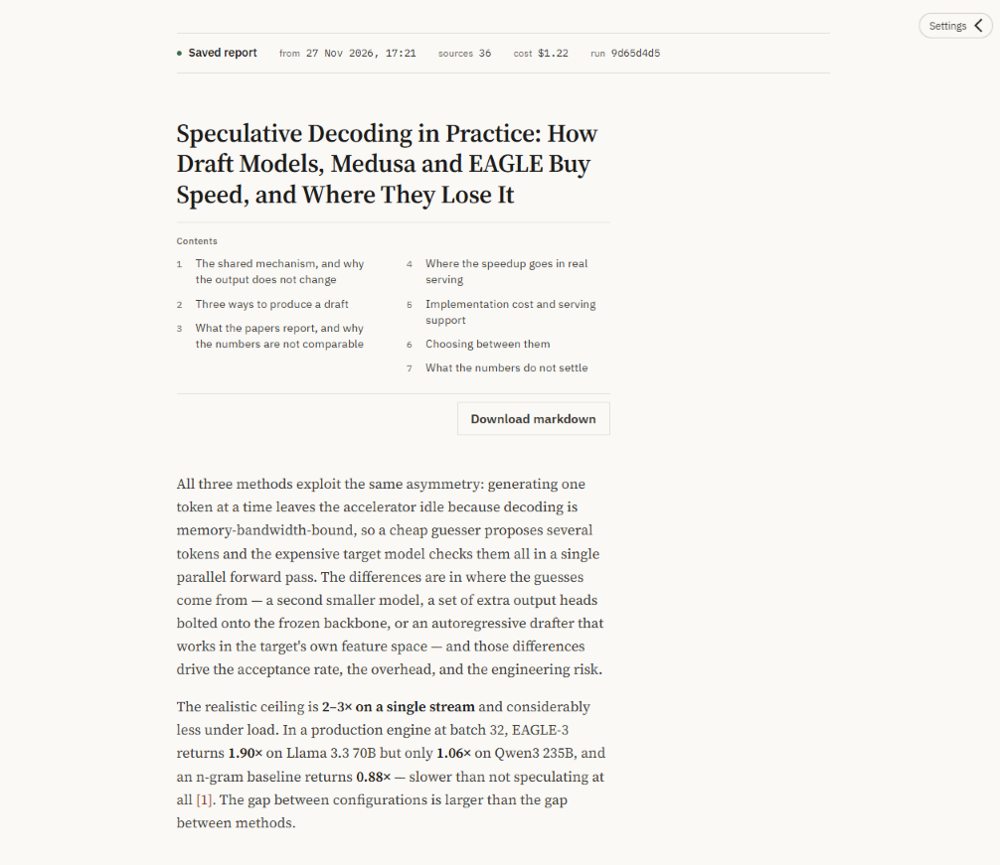
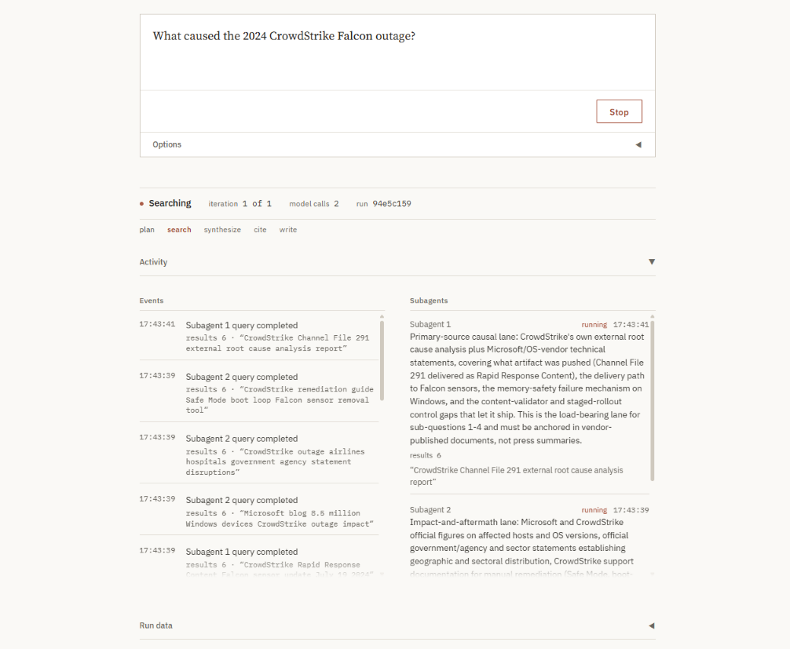
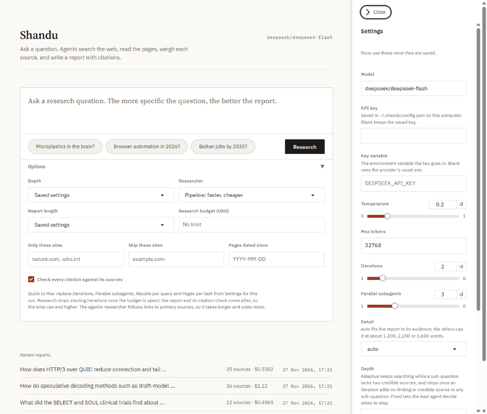
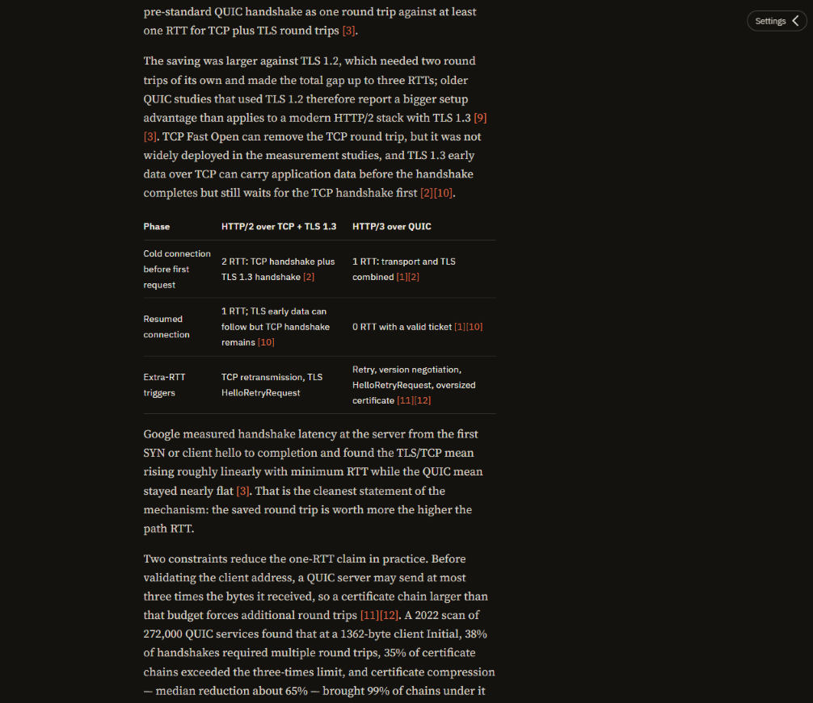
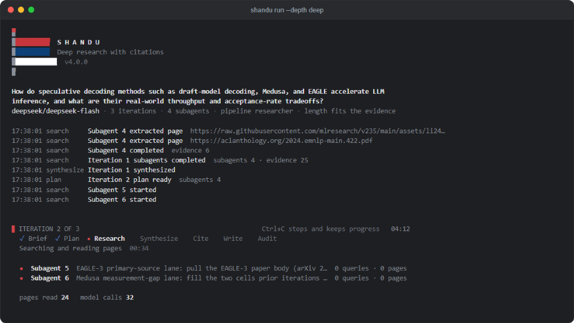
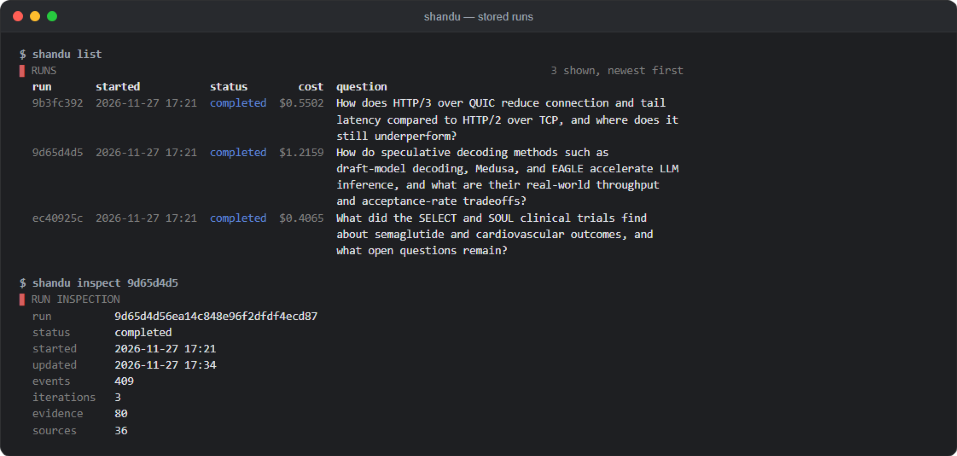
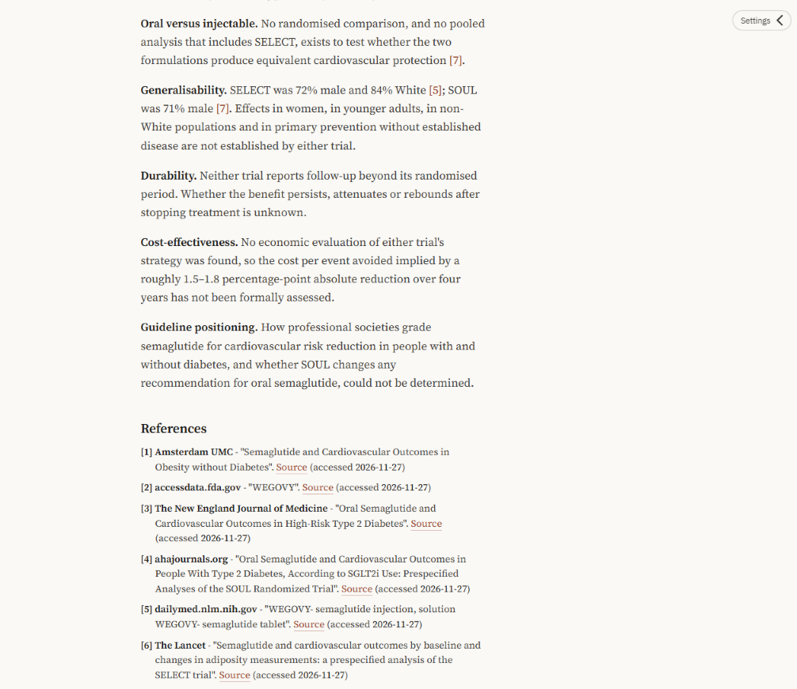

# Shandu

[](https://www.python.org/)
[](LICENSE)
[](https://docs.litellm.ai/)

Local deep research agent for the terminal and browser. Give it a question and it breaks it into sub-questions, searches the web and scholarly indexes in parallel, reads full pages and PDFs, scores source credibility, writes a report sized to the evidence, and audits every cited sentence against the underlying text.

Runs locally on [BlackGeorge](https://github.com/jolovicdev/blackgeorge) with any model [LiteLLM](https://docs.litellm.ai/) supports.



## Example reports

Unedited reports from `deepseek/deepseek-flash` (non-thinking mode), with citation audit counts from each run:

| Report | Depth | Sources | Citation audit | Cost |
|---|---|---|---|---|
| [Speculative decoding: draft models, Medusa, and EAGLE](examples/speculative-decoding-llms.md) | `deep` | 36 | 112 supported, 19 partial, 1 removed | $1.22 |
| [HTTP/3 over QUIC vs HTTP/2 over TCP](examples/http3-quic-latency.md) | `standard` | 25 | 101 supported, 20 partial, 0 removed | $0.55 |
| [SELECT and SOUL semaglutide cardiovascular trials](examples/glp1-cardiovascular-outcomes.md) | `standard` | 12 | 78 supported, 6 partial, 0 removed | $0.41 |

## Install and quick start

Requires Python 3.12 or newer.

```bash
pipx install shandu
```

`pip install shandu` works as well. For the latest code from GitHub:

```bash
pipx install "git+https://github.com/jolovicdev/shandu.git@main"
```

The default model is `deepseek/deepseek-flash`. Grab a key from [platform.deepseek.com](https://platform.deepseek.com) and export it:

```bash
export DEEPSEEK_API_KEY=your-key
```

Run a question from the terminal or open the web GUI:

```bash
shandu run "How does HTTP/3 over QUIC compare to HTTP/2 over TCP?"
shandu gui
```

To use another provider, set `SHANDU_MODEL` to its LiteLLM name (for example `anthropic/claude-sonnet-5.5`, `openai/gpt-6.2-astra`, or `openrouter/deepseek/deepseek-v4-flash`) and export that provider's key variable (`ANTHROPIC_API_KEY`, `OPENAI_API_KEY`, `OPENROUTER_API_KEY`, etc.). You can also run `shandu configure` to save defaults to `~/.shandu/config.json`, and `shandu info` to see what is active.

## Why it works this way

Most research tools either dump raw search snippets into one prompt or force every question into the same 3,000-word corporate template. Shandu splits planning, retrieval, verification, writing, and auditing into explicit stages backed by deterministic Python checks (full diagrams in [`ARCH.md`](ARCH.md)):

1. **Research brief**: the lead agent turns your question (plus any `--clarify` answers and site/date filters) into 3 to 8 concrete sub-questions and picks a deliverable shape.
2. **Parallel research**: subagents work the open sub-questions in parallel across web search and, when papers apply, arXiv, OpenAlex, and PubMed. Pages and PDFs are read whole rather than from search snippets.
3. **Quote and credibility checks**: every page is classified (peer-reviewed, official, journalism, vendor, blog, etc.) and scored. Claims must include verbatim quotes; any quote not found on the page is dropped in code.
4. **Coverage-driven loop**: code scores each sub-question by how many independent credible sites support it. The loop stops once coverage is strong, an iteration adds no new findings or credible sources, or the budget runs out.
5. **Dynamic reports**: under the default `--detail-level auto`, the outline and length follow the question and the evidence (under 300 words per cited source, floor 400). A narrow factual query stays short instead of getting padded with filler sections; a dense technical or clinical survey expands with comparison tables and caveats.
6. **Post-write citation audit**: an auditor checks every cited sentence, bullet, and table row against the actual evidence behind each `[n]` marker and strips citations the source does not support.

## Web GUI

```bash
shandu gui
```

Open `http://127.0.0.1:7860`, type a question, and click **Research**. While a run executes, the Activity panel streams live events on the left and active subagent cards on the right. Clicking **Stop** halts cleanly and keeps everything gathered so far so you can resume it from the CLI.



Open **Options** under the question to override depth, researcher mode, report length, USD cap, site allow/deny lists, publication start date, or citation auditing for a single run. Open **Settings** on the right to save your default model, API key, and orchestration limits. Recent runs sit right below the composer and open in one click without blocking an active run.



Both light and dark themes follow your system preference (or `?__theme=light` / `?__theme=dark`). Reports render with clickable contents links, comparison tables, fenced code blocks, and inline `[n]` links that jump straight to the reference entry.



To share a temporary public link, protect it with a password so strangers cannot spend your API key:

```bash
shandu gui --share --auth user:pass
```

## Terminal UI and CLI

In a color UTF-8 terminal, `shandu` opens with a short tricolor flag animation (`SHANDU_NO_INTRO=1` turns it off) and renders a live progress block underneath the scrolling event log showing the current iteration, stage tracker, active subagents, pages read, and model calls. When the run finishes, the progress block clears, the report prints (or writes to `--output`), and a compact summary prints the evidence counts, citation audit tally, token usage, cost, and sources.



Every run is persisted live to `~/.shandu/storage/runs/<run_id>/`, so you can inspect past runs, resume a stopped run from its last completed iteration, or rewrite a report with a different model or length without searching again. Run commands accept any unique ID prefix (such as the 8 characters printed by `shandu list`).



### Run options

| Option | What it does |
|---|---|
| `--depth quick\|standard\|deep\|max` | Research depth preset (table below). Explicit budget flags override it. |
| `--researcher pipeline\|agentic` | How each subagent gathers evidence. |
| `--detail-level auto\|concise\|standard\|high` | Report length. `auto` (default) fits the evidence; the others cap at roughly 1,200, 2,200, or 3,600 words. |
| `--depth-policy adaptive\|fixed` | `adaptive` (default) stops early once coverage is strong or stalls; `fixed` runs every iteration. |
| `--include-domain`, `--exclude-domain` | Restrict to or skip specific sites (repeatable). |
| `--since YYYY-MM-DD` | Skip pages dated before this day. |
| `--max-cost USD` | Stop starting new iterations once spend reaches this cap, then write the report. |
| `--clarify` | Answer up to three clarifying questions before planning. |
| `--no-audit` | Skip post-write citation verification. |
| `--output PATH` | Write the markdown report to a file instead of printing it. |
| `--json-output` | Emit the full result payload as clean JSON. |
| `--verbose` | Show raw event metrics in the stream. |

`shandu run --help` lists every flag, including individual budget overrides (`--max-iterations`, `--parallelism`, `--max-results-per-query`, `--max-pages-per-task`).

| Depth | Iterations | Parallel subagents | Pages per task | Results per query | Searches per task |
|---|---|---|---|---|---|
| `quick` | 1 | 2 | 3 | 6 | 3 |
| `standard` (default) | 2 | 3 | 6 | 8 | 6 |
| `deep` | 3 | 4 | 6 | 8 | 8 |
| `max` | 4 | 6 | 8 | 10 | 10 |

### Pipeline vs agentic researcher

- **`pipeline` (default)**: runs planned queries, ranks candidates with a model call, scrapes and extracts the best pages in one pass (replacing blocked or out-of-date pages for up to two rounds). Faster and cheaper.
- **`agentic`**: runs each task as a tool loop (`web_search`, `search_papers`, `read_page`) that refines queries from what it finds and follows outbound links from secondary articles to primary papers or filings. Slower and pricier, better when primary sources sit behind secondary coverage.

### Stored runs and quick answers

| Command | What it does |
|---|---|
| `shandu list` | List stored runs, newest first, with status and cost. |
| `shandu show <run_id>` | Print a stored run's summary and report. |
| `shandu report <run_id>` | Rewrite a report from stored evidence with no new searches (`--detail-level`, `--model`, `--no-audit`). |
| `shandu resume <run_id>` | Continue a stopped or failed run after its last completed iteration. |
| `shandu inspect <run_id>` | Show run status, timestamps, event count, evidence, and source counts. |
| `shandu aisearch "question"` | Single-round search and short cited answer for quick lookups. |
| `shandu clean` | Remove runtime caches while keeping stored runs (`--all` deletes runs too). |

## Source credibility and citation auditing

Every scraped page goes through layered extraction (`trafilatura`, `readability-lxml`, `BeautifulSoup`) plus parsers for PDF, DOCX, XLSX, CSV, and plain text, with SSRF checks, per-domain rate limits, and detection for paywalls, captchas, and empty JS shells.

Before writing, `CitationAgent` filters low-credibility pages out of the reference list and merges duplicate copies of the same work (HTML + PDF, DOI + publisher page, arXiv abstract + full text, or identical long titles across hosts) while keeping distinct DOIs and arXiv IDs separate. After writing, `CitationAuditor` verifies every cited sentence, bullet, and table row against the actual extracted text and verified quotes behind each marker, removing unsupported markers cleanly.



## Python API

```python
from shandu import ResearchRequest, ShanduEngine

engine = ShanduEngine.from_config()
try:
    result = engine.run_sync(
        ResearchRequest(
            query="How do solid-state batteries compare with lithium-ion?",
            depth="deep",
        )
    )
    print(result.report_markdown)
finally:
    engine.close()
```

Async callers can `await engine.run(request)` or stream `RunEvent` updates via `async for event in engine.stream(request): ...`, then `await engine.aclose()`.

## Configuration

Settings can come from environment variables, a local `.env` file, or `~/.shandu/config.json` (environment variables take precedence).

| Variable | Purpose |
|---|---|
| `SHANDU_MODEL` | Default model for all roles (`deepseek/deepseek-flash`). |
| `SHANDU_MODEL_PLANNER`, `_RESEARCHER`, `_EXTRACTOR`, `_SYNTHESIZER`, `_WRITER`, `_AUDITOR` | Override a single role. Extraction makes most of the calls, so pairing a cheap extractor with a stronger writer cuts cost fast. |
| `SHANDU_API_KEY_ENV`, `SHANDU_API_KEY` | Override the provider key variable name, or supply a key directly. |
| `SHANDU_TEMPERATURE`, `SHANDU_MAX_TOKENS` | Sampling temperature (default `0.2`) and output cap (default `32768`). |
| `SHANDU_STORAGE_DIR` | Run and cache directory (default `~/.shandu/storage`). |
| `SHANDU_SEARCH_BACKEND` | `ddgs` (default), or an API backend: `tavily` (`TAVILY_API_KEY`), `brave` (`BRAVE_API_KEY`), `exa` (`EXA_API_KEY`), or `searxng` (`SEARXNG_URL` with JSON enabled). Falls back to `ddgs` if unset. |
| `OPENALEX_API_KEY`, `NCBI_API_KEY` | Optional keys to raise OpenAlex and PubMed rate limits during scholarly search. |
| `SHANDU_PROXY` | Optional HTTP/HTTPS proxy for page fetches. |
| `SHANDU_NO_INTRO` | Set to `1` to disable the terminal flag animation. |

## Development

```bash
uv sync --dev
uv run pytest -q
uv run ruff check .
uv run mypy --ignore-missing-imports shandu
```

Architecture notes live in [`ARCH.md`](ARCH.md) and [`shandu/README.md`](shandu/README.md). MIT licensed.
